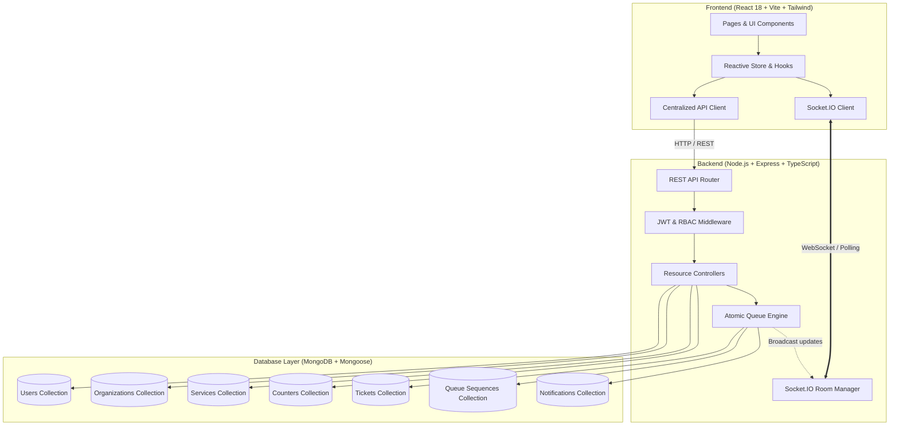

# SmartQueue — Real-Time Queue Management Application

SmartQueue is a full-stack, enterprise-grade, real-time queue management platform built with React 18, TypeScript, Tailwind CSS, Express.js, MongoDB (Mongoose), and Socket.IO.

It empowers multi-department organizations (hospitals, banks, government offices, private offices, educational institutes, and service centers) to manage queues digitally while allowing customers to search, join, and track their tokens live across any device.

---

## 1. Architecture Overview



---

## 2. Technology Stack

- **Frontend**:
  - React 18
  - TypeScript
  - Vite
  - React Router DOM v6
  - Tailwind CSS
  - Recharts
  - Socket.IO Client
- **Backend**:
  - Node.js (v18+)
  - Express.js
  - TypeScript
  - Socket.IO
  - Zod (request validation)
  - Helmet (HTTP security headers)
  - CORS with credential support
  - Express Rate Limiting
  - Cookie Parser
- **Database**:
  - MongoDB
  - Mongoose ODM
  - Embedded `mongodb-memory-server` fallback for zero-config local testing and dev
- **Authentication & Security**:
  - JSON Web Tokens (JWT)
  - bcrypt password hashing
  - Role-Based Access Control (RBAC: `CUSTOMER`, `STAFF`, `ADMIN`)
  - Organization-level data isolation
  - Atomic sequence allocation and concurrency-safe queue claims

---

## 3. Database Schema & Collections

| Collection | Key Fields | Indexes & Constraints |
|---|---|---|
| **User** | `name`, `email`, `passwordHash`, `role`, `organizationId`, `serviceId`, `counterId`, `status` | Unique compound on `email`. Passwords hashed with bcrypt (hidden by default). |
| **Organization** | `name`, `code`, `type`, `address`, `city`, `state`, `pin`, `lat`, `lng`, `open`, `email` | Unique index on `code` (`SQ-XXXX-XXXX`). Indexed by `city`, `type`, `pin`. |
| **Service** | `organizationId`, `name`, `prefix`, `averageServiceTime`, `enabled`, `open`, `capacity` | Compound index on `{ organizationId: 1, name: 1 }`. |
| **Counter** | `organizationId`, `name`, `serviceId`, `active` | Indexed by `organizationId`. |
| **Ticket** | `organizationId`, `serviceId`, `customerId`, `token`, `sequenceNumber`, `dateKey`, `status`, `counterId`, `staffId`, `calledAt`, `completedAt` | Unique compound index on `{ serviceId: 1, dateKey: 1, sequenceNumber: 1 }`. Query index on `{ customerId: 1, serviceId: 1, dateKey: 1, status: 1 }`. |
| **QueueSequence** | `organizationId`, `serviceId`, `dateKey`, `lastSequenceNumber` | Unique compound index on `{ serviceId: 1, dateKey: 1 }`. Lock-free atomic sequence numbering. |
| **Notification** | `userId`, `organizationId`, `message`, `type`, `read`, `createdAt` | Indexed by `userId`. |

---

## 4. Concurrency Safety & Critical Algorithms

### A. Atomic Token Number Allocation
To eliminate duplicate ticket generation when multiple customers join simultaneously:
```typescript
const seqDoc = await QueueSequence.findOneAndUpdate(
  { serviceId: service._id, dateKey },
  { $inc: { lastSequenceNumber: 1 }, $setOnInsert: { organizationId: org._id } },
  { upsert: true, new: true, setDefaultsOnInsert: true }
);
const token = `${service.prefix}-${String(seqDoc.lastSequenceNumber).padStart(3, '0')}`;
```
Together with the unique compound index on `Ticket` (`serviceId + dateKey + sequenceNumber`), duplicate ticket numbers cannot be generated.

### B. Single Staff Claim Atomicity
When staff members call "NEXT CUSTOMER" concurrently:
```typescript
const nextTicket = await Ticket.findOneAndUpdate(
  { serviceId: staffUser.serviceId, dateKey, status: 'WAITING' },
  { $set: { status: 'SERVING', staffId: staffUser._id, counterId: staffUser.counterId, calledAt: new Date() } },
  { sort: { sequenceNumber: 1 }, new: true }
);
```
MongoDB's atomic document locking ensures only one staff member claims any given ticket.

---

## 5. API Reference

All responses follow a consistent envelope format:
- **Success**: `{ "success": true, "message": "...", "data": { ... } }`
- **Error**: `{ "success": false, "message": "...", "errors": [ ... ] }`

### Authentication (`/api/auth`)
| Method | Endpoint | Access | Description |
|---|---|---|---|
| `POST` | `/api/auth/register` | Public | Register customer account. |
| `POST` | `/api/auth/register-organization` | Public | Register organization and first admin. |
| `POST` | `/api/auth/login` | Public | Login (returns JWT token and sets cookie). |
| `POST` | `/api/auth/logout` | Authenticated | Clears auth token/cookie. |
| `GET` | `/api/auth/me` | Authenticated | Returns current authenticated user. |
| `POST` | `/api/auth/forgot-password` | Public | Request password reset instructions. |
| `POST` | `/api/auth/reset-password` | Public | Reset password using valid token. |

### Organizations (`/api/organizations`)
| Method | Endpoint | Access | Description |
|---|---|---|---|
| `GET` | `/api/organizations` | Public | List organizations with optional filters (`type`, `city`, `code`, `query`). |
| `GET` | `/api/organizations/search` | Public | Organization search alias. |
| `GET` | `/api/organizations/:id` | Public | Get organization profile and live queue statistics. |
| `GET` | `/api/organizations/:id/services`| Public | Get active services and serving tokens. |

### Queues (`/api/queues`)
| Method | Endpoint | Access | Description |
|---|---|---|---|
| `POST` | `/api/queues/join` | Customer | Atomically join a service queue and receive token. |
| `GET` | `/api/queues/my-tickets` | Customer | List customer's tickets and live queue positions. |
| `GET` | `/api/queues/tickets/:id` | Authenticated | Get ticket details and serving position. |
| `GET` | `/api/queues/tickets/:id/position`| Authenticated | Get current serving token and wait time. |
| `DELETE` | `/api/queues/tickets/:id` | Customer | Cancel customer's own waiting ticket. |

### Staff Operations (`/api/staff`)
| Method | Endpoint | Access | Description |
|---|---|---|---|
| `GET` | `/api/staff/dashboard` | Staff | Staff metrics, counter info, and current token. |
| `GET` | `/api/staff/queue` | Staff | Service queue waiting list and current token. |
| `GET` | `/api/staff/current-ticket` | Staff | Active ticket being served by this staff member. |
| `POST` | `/api/staff/next` | Staff | Call next waiting customer atomically. |
| `POST` | `/api/staff/:ticketId/call` | Staff | Call specific waiting ticket. |
| `POST` | `/api/staff/recall` | Staff | Recall current serving token. |
| `POST` | `/api/staff/skip` | Staff | Transition current token to `SKIPPED`. |
| `POST` | `/api/staff/complete` | Staff | Transition current token to `COMPLETED`. |

### Admin Operations (`/api/admin`)
| Method | Endpoint | Access | Description |
|---|---|---|---|
| `GET` | `/api/admin/dashboard` | Admin | Real-time organization metrics & live queue list. |
| `GET` | `/api/admin/analytics` | Admin | 7-day trend, peak hours, dept distribution, staff stats. |
| `GET` | `/api/admin/customers` | Admin | Customer audit list with visit history. |
| `GET` / `POST` | `/api/admin/services` | Admin | List or create organization services. |
| `PUT` / `DELETE`| `/api/admin/services/:id` | Admin | Update or delete a service. |
| `GET` / `POST` | `/api/admin/counters` | Admin | List or create organization counters. |
| `PUT` / `DELETE`| `/api/admin/counters/:id` | Admin | Update or delete a counter. |
| `GET` / `POST` | `/api/admin/staff` | Admin | List or create staff members for this organization. |
| `PUT` / `DELETE`| `/api/admin/staff/:id` | Admin | Update or delete staff member. |
| `PATCH` | `/api/admin/staff/:id/status` | Admin | Toggle staff status (`ACTIVE` / `DISABLED`). |
| `PATCH` | `/api/admin/staff/:id/reset-password`| Admin | Reset staff password securely. |
| `GET` / `PUT` | `/api/admin/organization` | Admin | Get or update organization details and open status. |
| `POST` | `/api/admin/reset-demo` | Admin | Reset demo data (dev/test environments). |

---

## 6. Real-Time Socket.IO System

- **Client-to-Server**:
  - `join:organization` (`org:<organizationId>`)
  - `join:service` (`service:<serviceId>`)
  - `leave:service` (`service:<serviceId>`)
- **Server-to-Client**:
  - `queue:updated`: Broadcast to service room when tokens join, advance, skip, or complete.
  - `ticket:created`: Private to customer when ticket is generated.
  - `ticket:called`: Private to customer when called to counter.
  - `ticket:recalled`: Alert when staff calls token again.
  - `ticket:skipped`: Alert when customer was absent.
  - `ticket:completed`: Confirmation of service completion.
  - `ticket:cancelled`: Confirmation of customer leaving queue.
  - `notification:new`: Real-time notification drawer and toast popover.
  - `dashboard:updated`: Broadcast to organization room on config or state changes.

---

## 7. Local Development & Execution

### Prerequisites
- Node.js (v18.0.0 or higher)
- npm (v9.0.0 or higher)
- *(Optional)* Local MongoDB or MongoDB Atlas URI (an embedded MongoDB memory server is built-in for zero-config execution out of the box).

### Step 1: Install Dependencies
From the repository root:
```bash
npm run install:all
```
Or individually:
```bash
cd server && npm install
cd ../client && npm install
```

### Step 2: Environment Configuration
Environment configuration templates are provided:
- **Server (`server/.env.example`)**:
  ```env
  PORT=5000
  NODE_ENV=development
  MONGODB_URI=
  JWT_SECRET=smartqueue-super-secure-jwt-secret-key-32chars
  JWT_EXPIRES_IN=7d
  CLIENT_URL=http://localhost:5173
  COOKIE_SECRET=smartqueue-cookie-secret-key-12345
  ```
- **Client (`client/.env.example`)**:
  ```env
  VITE_API_URL=http://localhost:5000/api
  VITE_SOCKET_URL=http://localhost:5000
  ```

### Step 3: Run Database Seed Script
Populate demo organizations, services, counters, staff, and sample tickets:
```bash
npm run seed
```
*(Note: In development mode, the server also automatically seeds demo data if an empty database is detected).*

### Step 4: Start Development Servers
Run the backend:
```bash
npm run dev:server
```
Run the frontend:
```bash
npm run dev:client
```

- **Frontend**: http://localhost:5173
- **Backend API**: http://localhost:5000/api
- **Health Check**: http://localhost:5000/api/health

### Demo Accounts
Password for all demo accounts: `Demo@1234`
| Role | Email | Details |
|---|---|---|
| **Admin** | `admin@smartqueue.com` | Apollo Hospital (Code: `SQ-HOSP-1024`) |
| **Staff** | `staff@smartqueue.com` | Anita Sharma, General Consultation, Counter 1 |
| **Customer** | `customer@smartqueue.com` | Demo Customer Account |

---

## 8. Automated Testing

Run the full automated test suite (Auth, RBAC, Concurrency, State transitions, Operations):
```bash
npm test
```
The test suite utilizes Vitest, Supertest, and an in-memory database to execute 15 end-to-end integration and concurrency safety tests.

---

## 9. Production Build & Deployment

### Production Build
1. Build backend TypeScript:
   ```bash
   npm run build:server
   ```
   Outputs compiled JavaScript to `server/dist/`.
2. Build frontend React bundle:
   ```bash
   npm run build:client
   ```
   Outputs production assets to `client/dist/`.

### Running Production Backend
```bash
npm start
```

### Production Checklist
1. Set `NODE_ENV=production`.
2. Supply a secure production `MONGODB_URI` (such as MongoDB Atlas with replica sets enabled).
3. Set a strong, random 64-character `JWT_SECRET`.
4. Set `CLIENT_URL` to your production frontend domain (e.g. `https://smartqueue.yourdomain.com`).
5. Ensure HTTPS is enabled on your reverse proxy (Nginx, Caddy, or Cloudflare) for secure HTTP-only cookies and WebSocket upgrades.
